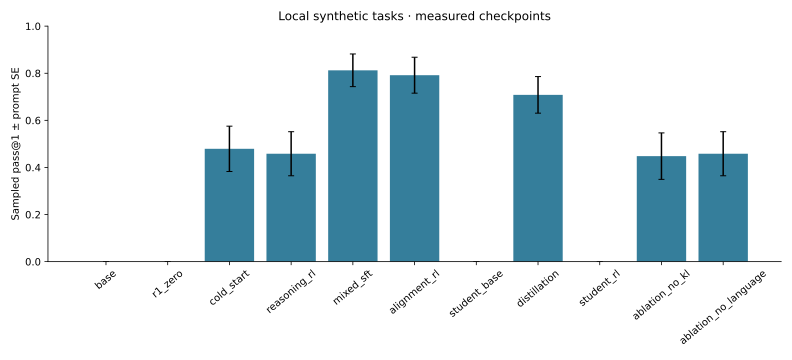
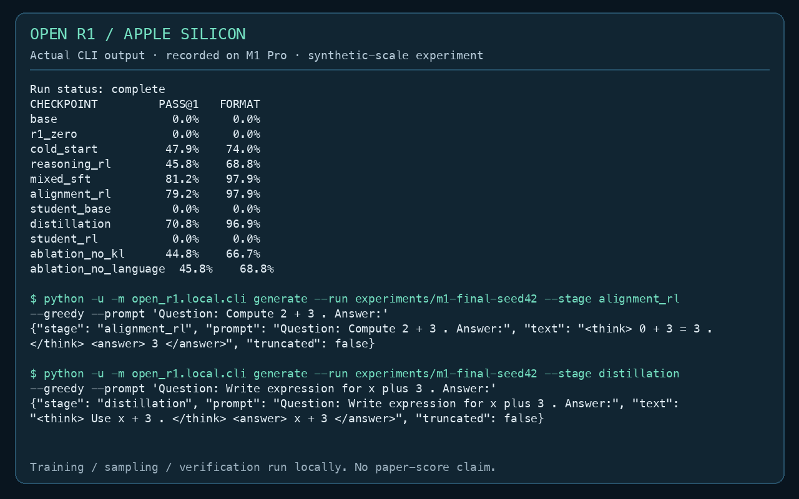
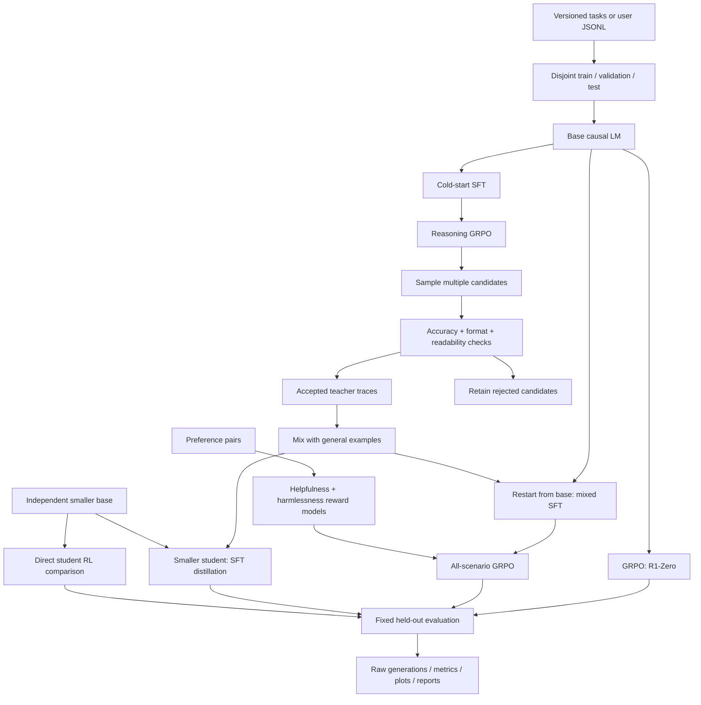
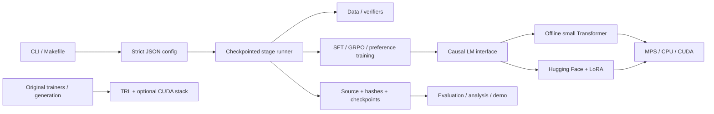

# R1 MacLab

**English** | [简体中文](README.zh-CN.md)

An Apple Silicon research lab for exploring the DeepSeek-R1 training pipeline through reproducible, small-scale
experiments with GRPO, multi-stage training, distillation, and transparent evaluation.

Run an inspectable R1 training pipeline on an M1 Mac: data preparation, R1-Zero, cold-start SFT,
reasoning GRPO, rejection sampling, mixed SFT, preference rewards, alignment RL, distillation and evaluation.
The original Hugging Face distributed trainers, generation tools, reward functions and cluster recipes remain available.

**Scope:** the default is a real, small synthetic experiment with trainable causal Transformers. It is **not**
DeepSeek-R1 weights or a reproduction of its benchmark scores. A 16 GB M1 cannot reproduce the 671B training run.
The [paper audit](docs/PAPER_COVERAGE.md) identifies implemented mechanisms, reduced substitutes and missing full-scale
experiments. Upstream's original documentation is preserved in [UPSTREAM_README.md](docs/UPSTREAM_README.md).

## Run on a Mac

Use native **arm64 Python 3.11**, not Rosetta. Validated on **M1 Pro, 16 GB RAM, macOS 26.6.1, PyTorch 2.6.0**.
Other M1 variants were not physically tested. CPU is also supported. The local pipeline needs no API keys, cloud account,
vLLM, FlashAttention, DeepSpeed or bitsandbytes.

```bash
# Install Python first if needed: brew install python@3.11
make install-mac
source .venv/bin/activate
open-r1 doctor

# Complete offline experiment after dependency installation
open-r1 run --config recipes/local/m1.json --output experiments/my-m1-run
open-r1 verify --run experiments/my-m1-run
open-r1 report --run experiments/my-m1-run

# Generate from a saved checkpoint
open-r1 generate --run experiments/my-m1-run --stage alignment_rl --greedy \
  --prompt 'Question: Compute 2 + 3 . Answer:'
```

`auto` chooses MPS, then CUDA, then CPU. Set `--device cpu` to run the same experiment without Metal.
For this tiny model, CPU was faster on the tested M1: the complete CPU validation took about 19 stage-seconds,
versus 149–181 for the MPS runs. These are recorded run times, not an isolated hardware benchmark; larger models
have different tradeoffs. Start with `--device cpu` for a quick demonstration, or use MPS to exercise the GPU path.
The default teacher has 249,600 parameters; the independently initialized student has 69,504 parameters.
They learn the bundled grammar, not general conversation. Inference generates tokens from saved weights;
the verifier does not supply answers.

For the exact recorded dependency versions, run from the repository root:

```bash
python3.11 -m venv .venv
.venv/bin/python -m pip install -r requirements/macos-arm64-py311.lock.txt
```

The lock records macOS arm64 / Python 3.11. Elsewhere use `pip install -e '.[mac,tests]'`.
The `mac` extra selects portable dependencies and also works on CPU.

## Recorded experiments

[Cross-seed analysis](experiments/ANALYSIS.md) includes measured results and limitations. Each run retains raw JSONL
inputs and generations, loss/reward/KL diagnostics, CSV summaries, SVG plots, saved weights, resolved configuration,
source snapshots and SHA-256 manifests.

| Evidence | Purpose |
|---|---|
| [Seed 42](experiments/m1-final-seed42/REPORT.md), [43](experiments/m1-final-seed43/REPORT.md), [44](experiments/m1-final-seed44/REPORT.md) | Complete local pipeline, no-KL and no-language-reward ablations |
| [Validation receipts](experiments/VALIDATION.md) | Algorithm tests, upstream trainers, pretrained model and CPU/MPS checks |
| [Paper coverage](docs/PAPER_COVERAGE.md) | Exact scope and unreproduced experiments |

Evaluation uses a fixed held-out synthetic split, 24 prompts and four completions per prompt. Metrics include sampled
pass@1, pass@4, majority vote, formatting, length and truncation. General/safety templates share semantics across splits;
their scores do not establish generalization or safety. Short RL does **not** consistently improve accuracy. Negative
outcomes and zero-variance reward groups are retained.



## Demo video

[](assets/demo/open-r1-m1.mp4)

**[Watch / download MP4](assets/demo/open-r1-m1.mp4)** · [raw recording](assets/demo/session.cast) ·
[command exit codes](assets/demo/commands.json)

<video controls preload="metadata" poster="assets/demo/poster.png" src="assets/demo/open-r1-m1.mp4" width="900">
  <a href="assets/demo/open-r1-m1.mp4">Download the demo video</a>
</video>

This is a replay of actual CLI output: MPS diagnostics, artifact verification, measured results and checkpoint inference.
Idle gaps are shortened and reading time added; the raw recording preserves actual timing. GitHub may suppress the HTML
player, so use the image or download link.

The recording deliberately retains an incorrect arithmetic answer alongside a correct code expression. It demonstrates
the running system and its limits, not guaranteed reasoning correctness.

Record your own run:

```bash
brew install ffmpeg                 # Only needed to render the video
python scripts/record_local_demo.py --run experiments/my-m1-run
```

## Data flow



The second SFT starts from **base**, not the reasoning RL checkpoint. Distillation uses the rejection-sampled mixture
and SFT only. Rejected samples are never replaced by reference answers to make a failed experiment look successful.

## Architecture



```text
src/open_r1/
  local/                  Portable pipeline, verifiers, metrics and CLI
  sft.py, grpo.py          Original TRL trainers, also validated on MPS
  generate.py, rewards.py  Original generation and broader rewards
recipes/local/            M1, CPU smoke, pretrained LoRA and TRL recipes
experiments/              Actual data, checkpoints, plots and analysis
scripts/                  Dataset export, seed aggregation, demo recording
assets/demo/              MP4, poster, raw recording and command receipts
docs/                     Paper audit, local guide, original documentation
```

## Resume and customize

```bash
open-r1 inspect --run experiments/my-m1-run
open-r1 run --config recipes/local/m1.json --output experiments/my-m1-run --resume
open-r1 run --config recipes/local/m1.json --output experiments/cold-only --until cold_start

# Fast smoke test: deliberately too short for useful distillation
open-r1 run --config recipes/local/smoke.json --output experiments/smoke --until reasoning_rl
```

Resume validates configuration, data, source and completed artifacts. An interrupted stage restarts from its parent;
mid-step optimizer recovery is not implemented. Use a new directory after changing configuration or source. Nonempty
directories are never silently overwritten. Zero accepted rejection-sampling traces stop the run and remain on disk.

Edit a copy of `recipes/local/m1.json` to change budgets. `dataset` accepts JSONL with `id`, `task`, `prompt`, `answer`,
`completion`, `source`, `split` (`train`, `validation`, `test`). Tasks: `math`, `logic`, `code`, `general`, `safety`.
Code rows also need `tests: [{"x": 2, "y": 5}]`; answers are bounded integer expressions in `x`, not arbitrary programs.
Reference completions must pass verification. The tiny tokenizer supports the bundled English grammar; use the HF
backend for broader vocabulary. See the [local guide](docs/LOCAL_GUIDE.md).

## Pretrained models and original trainers

The HF backend loads a pinned model and trains float32 LoRA adapters. `pythia70m.json` is a bounded integration recipe,
not a competitive reasoning model. It expects cached weights; explicitly download them first or set `local_files_only`
to `false`. Its student uses the same backbone size, so only the offline experiment demonstrates size reduction.

```bash
HF_HUB_OFFLINE=1 open-r1 run --config recipes/local/pythia70m.json \
  --output experiments/my-pretrained-run --until cold_start

# Original SFTTrainer / GRPOTrainer on MPS
python scripts/prepare_local_dataset.py
HF_HUB_OFFLINE=1 python src/open_r1/sft.py --config recipes/local/trl_sft.yaml
HF_HUB_OFFLINE=1 python src/open_r1/grpo.py --config recipes/local/trl_grpo.yaml
```

For large cluster runs install `.[dev,cuda,generate]` on Linux/CUDA and follow the
[original guide](docs/UPSTREAM_README.md). Slurm, LightEval, broader math rewards and external code sandboxes remain;
their large experiments were not rerun on this Mac.

## Validation

```bash
python -m pytest tests/local tests/test_rewards.py tests/utils -q
python -m pip check
open-r1 verify --run experiments/m1-final-seed42
```

Upstream dataset tests may access Hugging Face; local algorithm tests are offline. Tests cover clipping, group
normalization, KL, completion masks, updates, checkpoint reload, empty rejection, split integrity, code verification and
tamper detection. CI checks CPU on Linux/macOS; MPS was checked on the physical machine. Remote sandbox tests still
require their original services.

## Attribution

Based on [Hugging Face Open R1](https://github.com/huggingface/open-r1) and the
[DeepSeek-R1 report](https://arxiv.org/abs/2501.12948). See PyTorch's
[MPS documentation](https://docs.pytorch.org/docs/2.6/notes/mps.html). Upstream is no longer maintained;
this fork does not imply upstream support. Code remains under [Apache 2.0](LICENSE).
