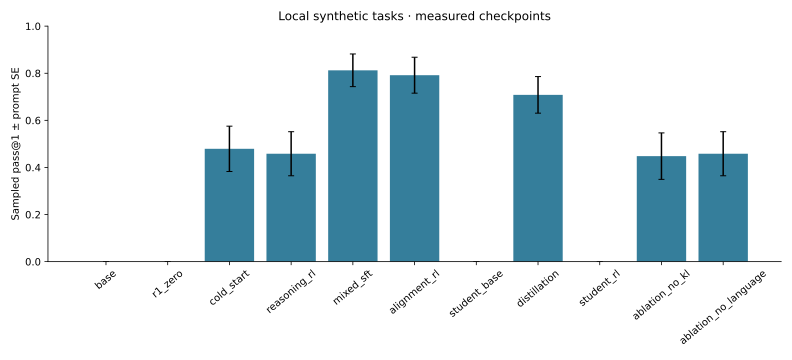
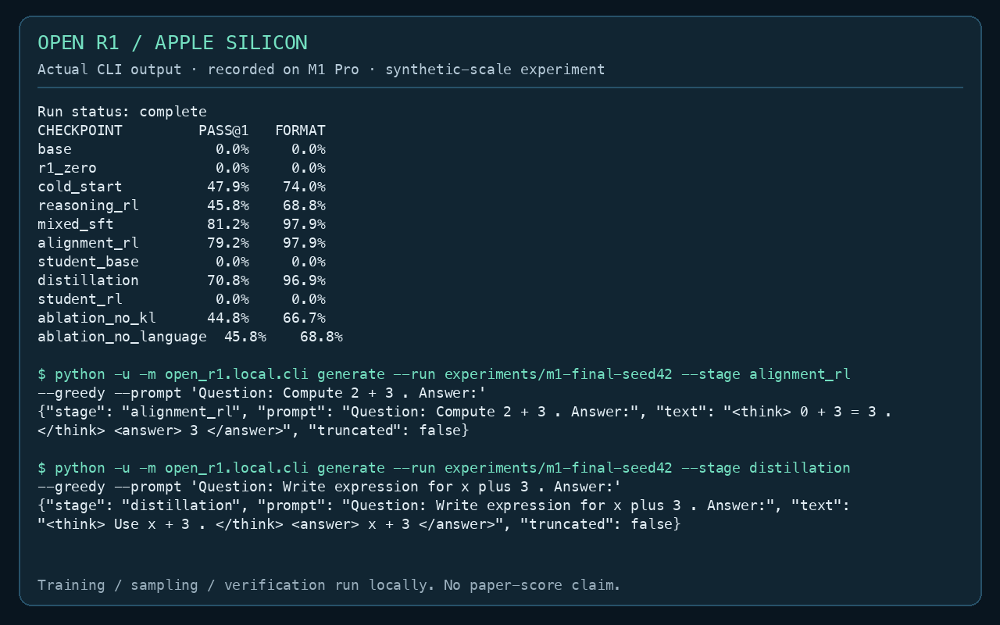
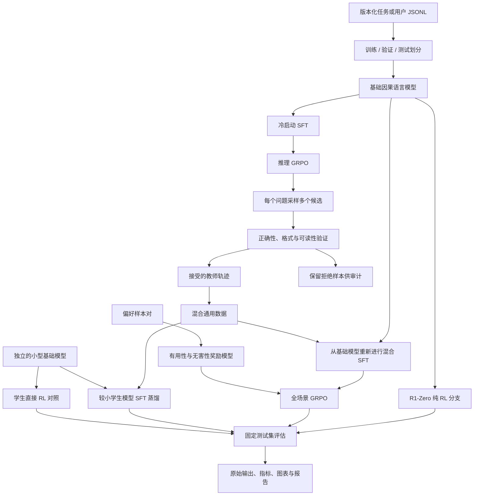
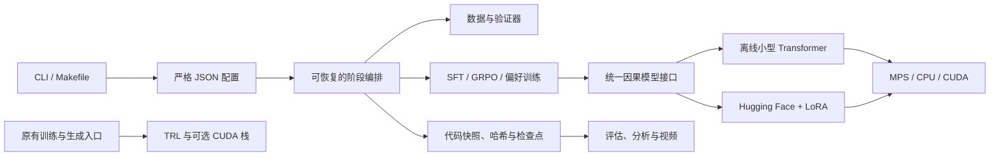

# R1 MacLab

[English（默认）](README.md) | **简体中文**

在 M1 Mac 上运行可检查、可复现的 R1 训练流程：数据准备、R1-Zero、冷启动 SFT、推理 GRPO、拒绝采样、
混合 SFT、偏好奖励模型、对齐 RL、蒸馏和评估。保留原有 Hugging Face 分布式训练、数据生成、奖励函数及集群配置。

**复现范围：**默认流程使用真实可训练的小型因果 Transformer 和合成任务，**不等于** DeepSeek-R1 模型或论文榜单复现。
16 GB M1 无法完成论文 671B 模型的等规模训练。[论文对照表](docs/PAPER_COVERAGE.md) 明确区分已实现的机制、缩小后的替代项和
尚未复现的大规模实验。[原始文档](docs/UPSTREAM_README.md) 完整保留。

## 在 Mac 上运行

使用原生 **arm64 Python 3.11**，不要使用 Rosetta。实际验证环境：**M1 Pro、16 GB 内存、macOS 26.6.1、PyTorch 2.6.0**。
其他 M1 型号尚未做实机验证；同时支持 CPU。本地流程无需 API Key、云账户、vLLM、FlashAttention、DeepSpeed 或 bitsandbytes。

```bash
# 如未安装 Python：brew install python@3.11
make install-mac
source .venv/bin/activate
open-r1 doctor

# 安装依赖后，全流程可离线运行
open-r1 run --config recipes/local/m1.json --output experiments/my-m1-run
open-r1 verify --run experiments/my-m1-run
open-r1 report --run experiments/my-m1-run

# 从实际保存的模型生成结果
open-r1 generate --run experiments/my-m1-run --stage alignment_rl --greedy \
  --prompt 'Question: Compute 2 + 3 . Answer:'
```

`auto` 按 MPS、CUDA、CPU 的顺序选择设备；添加 `--device cpu` 可禁用 Metal。默认教师模型为两层小型 Transformer，
教师和学生分别为 249,600 和 69,504 个参数，学生模型独立初始化。它们学习的是随项目提供的任务语法，并非通用聊天能力。
推理时由模型生成 token，验证器不提供答案。

对这个微型模型，本机 CPU 更快：完整 CPU 验证的阶段耗时合计约 19 秒，MPS 三次运行约 149–181 秒。
这些是实际运行时间，并非隔离的硬件性能基准；更大模型的情况不同。快速演示可加 `--device cpu`，需要验证 GPU 路径则使用 MPS。

使用本次运行的精确依赖版本，请在项目根目录执行：

```bash
python3.11 -m venv .venv
.venv/bin/python -m pip install -r requirements/macos-arm64-py311.lock.txt
```

锁定文件对应 macOS arm64 / Python 3.11。其他平台使用 `pip install -e '.[mac,tests]'`；`mac` 扩展选择可移植依赖，也支持 CPU。

## 已保存的实验

[多随机种子分析](experiments/ANALYSIS.md) 包含实测结果和局限。每次运行保存 JSONL 输入与生成结果、逐步 loss/reward/KL、
CSV 汇总、SVG 图表、权重、实际配置、代码快照及 SHA-256 清单。

| 实验记录 | 用途 |
|---|---|
| [种子 42](experiments/m1-final-seed42/REPORT.md)、[43](experiments/m1-final-seed43/REPORT.md)、[44](experiments/m1-final-seed44/REPORT.md) | 完整本地流程，去除 KL / 语言奖励的消融 |
| [验证记录](experiments/VALIDATION.md) | 算法测试、原始训练入口、预训练模型及 CPU/MPS 对照 |
| [论文覆盖表](docs/PAPER_COVERAGE.md) | 具体实现范围与未完成的论文实验 |

评估使用固定的合成测试集子集：24 个问题，每题采样 4 次，记录 pass@1、pass@4、多数投票、格式、长度和截断率。
通用/安全任务在不同划分间共享语义模板，因此不能据此判断真实泛化或安全性。短预算 RL **并不稳定提升准确率**；
负结果与奖励方差为零的情况均保留在报告中。



## 演示视频

[](assets/demo/open-r1-m1.mp4)

**[观看 / 下载 MP4](assets/demo/open-r1-m1.mp4)** · [原始终端记录](assets/demo/session.cast) ·
[命令退出码](assets/demo/commands.json)

<video controls preload="metadata" poster="assets/demo/poster.png" src="assets/demo/open-r1-m1.mp4" width="900">
  <a href="assets/demo/open-r1-m1.mp4">下载演示视频</a>
</video>

视频重放真实命令输出：MPS 检查、文件校验、实验结果和模型推理。为便于观看，缩短空闲等待并增加文字停留时间；
原始记录保留真实时间戳。GitHub 可能不显示 HTML 播放器，可点击封面或下载链接。

录制中保留了一次错误的算术回答及一次正确的代码表达式，展示真实系统和局限，不代表推理结果始终正确。

```bash
brew install ffmpeg                 # 仅制作视频时需要
python scripts/record_local_demo.py --run experiments/my-m1-run
```

## 数据流图



第二轮 SFT 从**基础模型**重新开始，不从推理 RL 权重继续；蒸馏仅使用 SFT 和拒绝采样后的混合数据。
不会用参考答案替换失败输出来制造“采样成功”。

## 结构流程图



```text
src/open_r1/
  local/                  本地流程、验证器、评估及 CLI
  sft.py, grpo.py          原始 TRL 训练入口，已验证 MPS
  generate.py, rewards.py  原有生成与完整奖励功能
recipes/local/            M1、CPU 冒烟、预训练 LoRA、TRL 配置
experiments/              实际数据、检查点、图表及分析
scripts/                  数据导出、多种子汇总、视频录制
assets/demo/              MP4、封面、原始录制与退出码
docs/                     论文对照、本地指南及原始文档
```

## 恢复运行与定制

```bash
open-r1 inspect --run experiments/my-m1-run
open-r1 run --config recipes/local/m1.json --output experiments/my-m1-run --resume
open-r1 run --config recipes/local/m1.json --output experiments/cold-only --until cold_start

# 快速验证安装和算法，不足以获得有意义的蒸馏数据
open-r1 run --config recipes/local/smoke.json --output experiments/smoke --until reasoning_rl
```

恢复时检查配置、数据、代码及已完成产物的哈希。中断阶段会从父阶段重新执行，不恢复单个优化步骤中的状态。
修改配置或源码后请换新目录。非空目录不会静默覆盖；拒绝采样没有成功输出时停止下游训练，并保留失败证据。

复制 `recipes/local/m1.json` 调整预算。自定义 `dataset` 指向 JSONL，要求包含 `id`、`task`、`prompt`、`answer`、
`completion`、`source`、`split`（`train`、`validation`、`test`）。任务类型为 `math`、`logic`、`code`、`general`、`safety`。
代码任务另需 `tests: [{"x": 2, "y": 5}]`，答案限定为含 `x` 的整数表达式，不执行任意程序。参考答案必须通过验证。
微型模型的分词器仅支持内置英文任务语法，更广词汇请用 HF 后端。详见[本地指南](docs/LOCAL_GUIDE.md)。

## 预训练模型及原始入口

HF 后端加载指定修订版本的模型，使用 float32 LoRA。`pythia70m.json` 是有界的集成验证配置，不是高性能推理模型。
默认使用已缓存权重；首次运行可主动下载，或将 `local_files_only` 设为 `false`。
HF 后端的学生模型使用相同大小的基础模型，因此只有离线微型实验演示参数规模缩减。

```bash
HF_HUB_OFFLINE=1 open-r1 run --config recipes/local/pythia70m.json \
  --output experiments/my-pretrained-run --until cold_start

python scripts/prepare_local_dataset.py
HF_HUB_OFFLINE=1 python src/open_r1/sft.py --config recipes/local/trl_sft.yaml
HF_HUB_OFFLINE=1 python src/open_r1/grpo.py --config recipes/local/trl_grpo.yaml
```

大规模实验请在 Linux/CUDA 环境安装 `.[dev,cuda,generate]` 并参照[原始指南](docs/UPSTREAM_README.md)。Slurm、LightEval、
更广泛的数学奖励和外部代码沙箱功能均保留；这些大规模实验没有在本 Mac 上重跑。

## 验证

```bash
python -m pytest tests/local tests/test_rewards.py tests/utils -q
python -m pip check
open-r1 verify --run experiments/m1-final-seed42
```

原有数据集测试可能访问 Hugging Face，本地算法测试离线运行。覆盖裁剪、组归一化、KL、生成部分掩码、权重更新、
检查点恢复、空采样、数据划分、代码验证和产物篡改检查。CI 在 Linux/macOS 上验证 CPU，MPS 在本机验证。
远程代码沙箱测试仍需原有服务。

## 致谢与许可

基于 [Hugging Face Open R1](https://github.com/huggingface/open-r1) 和
[DeepSeek-R1 技术报告](https://arxiv.org/abs/2501.12948)。参见 PyTorch 的
[MPS 文档](https://docs.pytorch.org/docs/2.6/notes/mps.html)。上游已停止维护，本分支不代表上游提供支持。
代码继续使用 [Apache 2.0](LICENSE) 许可。
