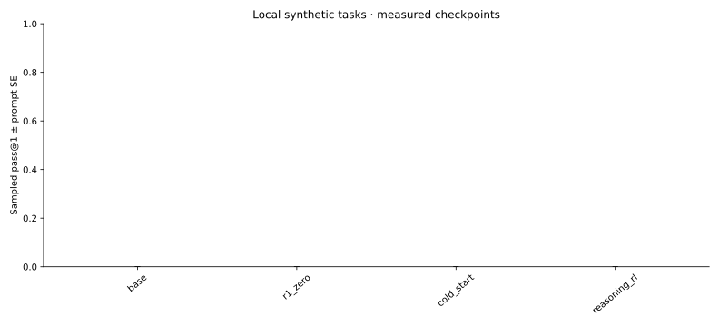
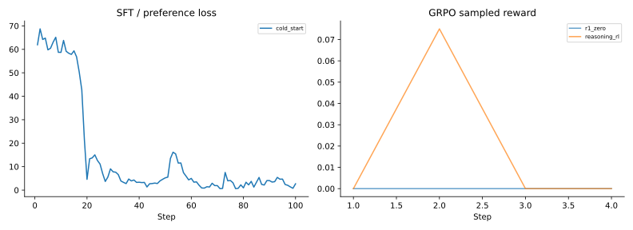

# Recorded local experiment

Status: **failed**. Reduced synthetic pipeline experiment; not DeepSeek-R1 benchmark reproduction.

Hardware: `Apple M1 Pro`; device: `mps`; PyTorch: `2.6.0`.

Each checkpoint uses the same held-out prompts and evaluation seed. pass@1 is the mean success rate across sampled completions; SE clusters completions by prompt. pass@k estimates at least one success, not majority voting. The tiny test set is insufficient for claims about general reasoning or safety.

| Checkpoint | pass@1 | SE | pass@k | Majority | Format | Truncated | Seconds |
|---|---:|---:|---:|---:|---:|---:|---:|
| base | 0.000 | 0.000 | 0.000 | 0.000 | 0.000 | 1.000 | 39.5 |
| r1_zero | 0.000 | 0.000 | 0.000 | 0.000 | 0.000 | 1.000 | 36.5 |
| cold_start | 0.000 | 0.000 | 0.000 | 0.000 | 0.000 | 1.000 | 27.5 |
| reasoning_rl | 0.000 | 0.000 | 0.000 | 0.000 | 0.000 | 1.000 | 39.2 |

## Interpretation

These measurements validate execution of the stages, not reproduction of the paper's scores. The synthetic model starts from a small equation/text language-model bootstrap. General and safety examples hold out prompt IDs but share templates. Strict answer tags are required by the local verifier; unformatted base outputs therefore score zero even if they contain a correct number.

- `reasoning_rl` minus `cold_start`: +0.000 pass@1. This is a descriptive difference, not a significance test or a compute-matched comparison.

## RL diagnostics

| Stage | Updates | Zero-variance groups | Mean reward | Mean KL |
|---|---:|---:|---:|---:|
| r1_zero | 8 | 100.0% | 0.0000 | 0.00000 |
| reasoning_rl | 8 | 75.0% | 0.0188 | 0.00363 |

Zero-variance reward groups have zero policy advantages. A pipeline can execute correctly without improving task accuracy. Raw sampled traces and per-prompt results are retained alongside these aggregates.

## Limits

No AIME, MATH-500, GPQA, LiveCodeBench, Codeforces, MMLU, multilingual benchmark, human preference or emergent self-reflection result is established here. The local code task interprets bounded integer expressions only. Process reward models and MCTS were unsuccessful explorations in the paper, not components of its successful pipeline; they are not reproduced by this experiment.
